# NEON CLUB LIVE

**English** · [Türkçe](README.tr.md)

An open-source, interactive 3D nightclub for live streams. Viewers type `!join` (or `!katıl`) in the live chat of
**YouTube, Twitch, Kick or TikTok** and get their own rigged human avatar that walks in through the door, finds a
free spot and dances in sync with the music. Up to **1,510 avatars** fit in the club (dance floor + balcony).
Everything runs locally on your PC: a Node.js server, a browser page that OBS captures, and an admin panel you
can also open on your phone. No paid AI services are used.

* `/live` – full-screen stream output (add it to OBS)
* `/admin` – control panel (English / Turkish), never shown on stream

> This project is not affiliated with or endorsed by Google/YouTube, Twitch, Kick or TikTok/ByteDance.
> All product names are trademarks of their respective owners.


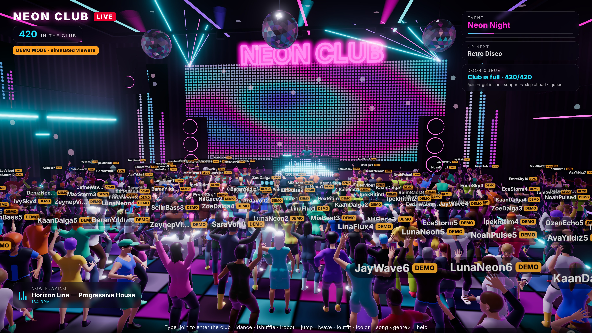

---

## Contents

1. [Features](#1-features) · [Screenshots](#screenshots)
2. [Requirements](#2-requirements)
3. [Install and start](#3-install-and-start)
4. [Connect YouTube](#4-connect-youtube)
5. [Twitch, Kick and TikTok](#5-twitch-kick-and-tiktok)
6. [Chat commands](#6-chat-commands)
7. [Capacity, balcony and door queue](#7-capacity-balcony-and-door-queue)
8. [Super Chats, gifts and memberships](#8-super-chats-gifts-and-memberships)
9. [Music](#9-music)
10. [OBS](#10-obs)
11. [Control from your phone (Tailscale)](#11-control-from-your-phone-tailscale)
12. [Performance and benchmark](#12-performance-and-benchmark)
13. [Demo mode and tests](#13-demo-mode-and-tests)
14. [Characters and assets](#14-characters-and-assets)
15. [Project layout, contributing, licence](#15-project-layout-contributing-licence)

---

## 1. Features

* **3D club** (Three.js / WebGL 2): LED dance floor, DJ booth with an animated DJ, LED walls, VIP area, lounge,
  bar, red carpet entrance, neon signs, a balcony with stairs, speakers, mirror balls, lasers, moving heads, haze,
  bloom. Lights, LEDs and lasers react to the beat.
* **Rigged human characters** built from the CC0 MakeHuman base mesh: 8 body types, many outfits, hair styles,
  hats, glasses and colours. One look per viewer, remembered between visits.
* **37 original motions** (22 dances, group choreographies, couple dance, walk, run, sit, gestures, DJ moves) with
  IK – feet stay planted, dances are locked to the music's beat.
* **Crowd system**: path finding over two floors, place reservation (nobody overlaps), the ~50–220 avatars nearest
  the camera are full characters, everyone else is drawn by an instanced **GPU crowd**.
* **Live chat**: YouTube (official API), Twitch (official EventSub), Kick (official webhooks), TikTok (optional,
  unofficial). Turkish and English commands, cooldowns, spam / profanity / name filters, blocking.
* **Supporter effects**: banner, follow spot, LED thank-you, golden avatar, confetti, close-up camera, light show,
  fireworks, stage time – all cosmetic, queued, never replayed.
* **Door queue** when the club is full, with optional priority for supporters.
* **Automatic camera director** (13 shots, 10–25 s, smooth cuts, no clipping through walls or people).
* **Events** (Neon Night, Retro Disco, Techno Festival, 90s, Dance Battle, Choreography, DJ Show, Laser Show,
  Colour Party, Rooftop) chosen by chat votes.
* **Music player** for your own files + an original built-in generative synth; beat / BPM detection.
* **Admin panel** in English and Turkish; can be opened from a phone over Tailscale.
* **Demo mode** with 10 – 1,500 simulated viewers, clearly labelled as simulation.

## Screenshots

All screenshots: 3840×2160, demo mode (simulated viewers, labelled DEMO), rendered by the app itself.

| | |
| --- | --- |
|  | 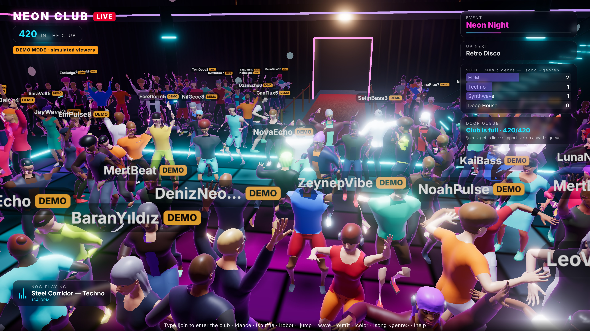 |
| Main floor – Neon Night | Crowd orbit shot |
| 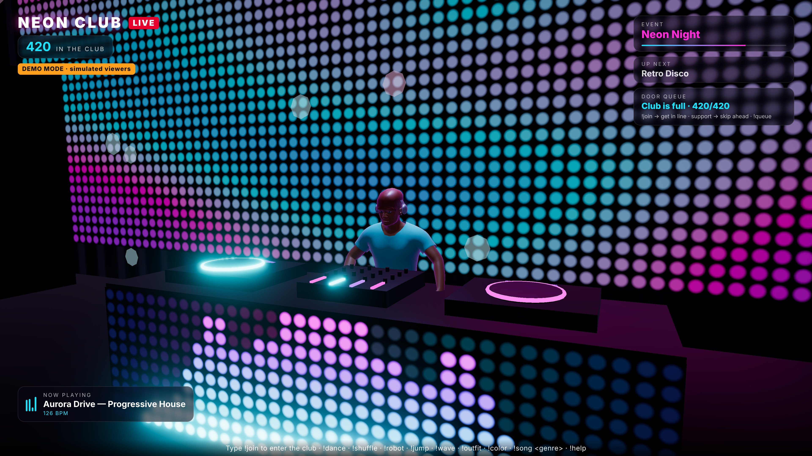 | 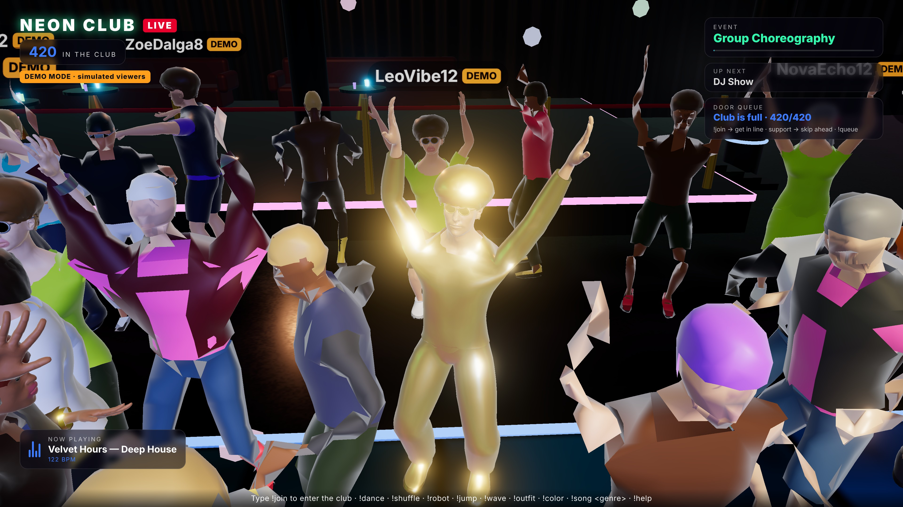 |
| DJ booth | Supporter close-up (simulated Super Chat) |
| 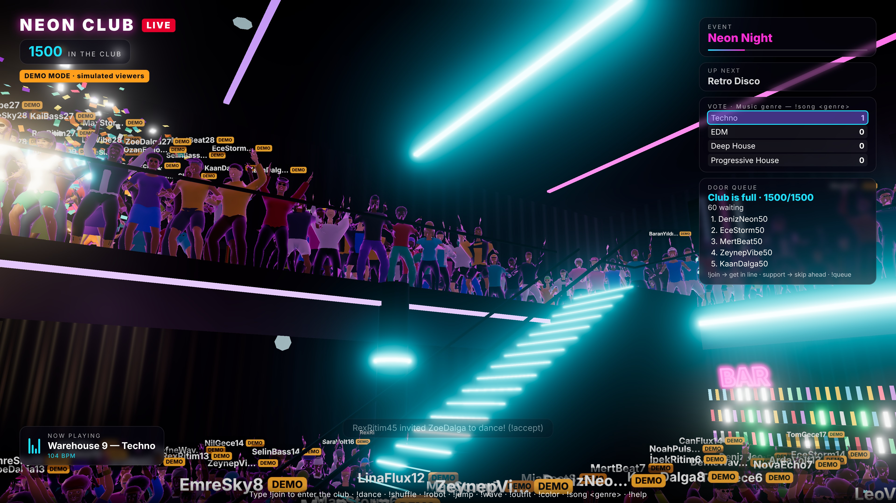 | 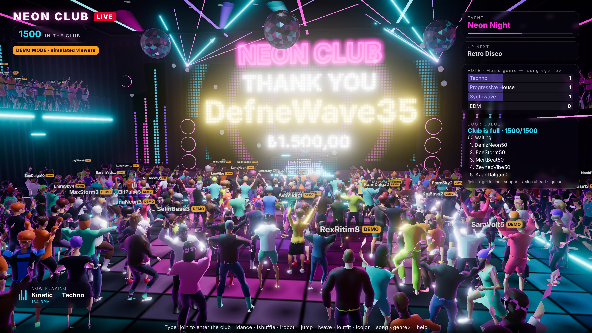 |
| 1,500 avatars – balcony | Full club and door queue |
| 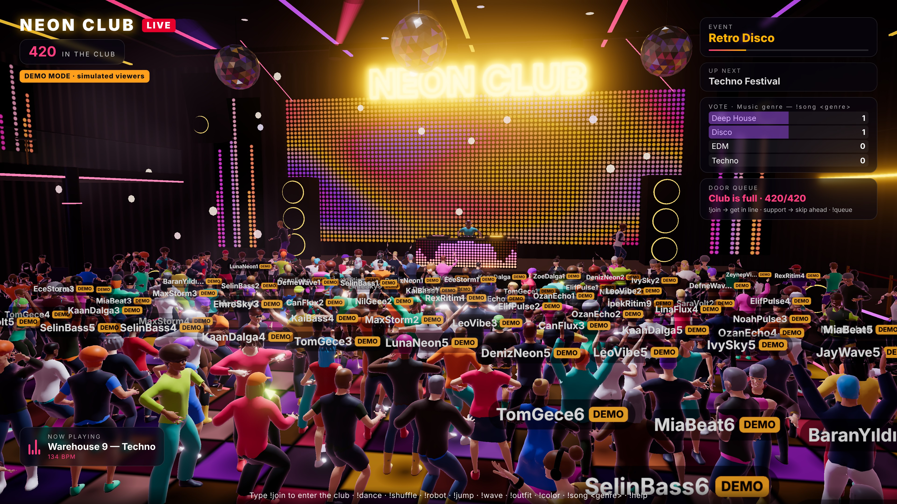 | 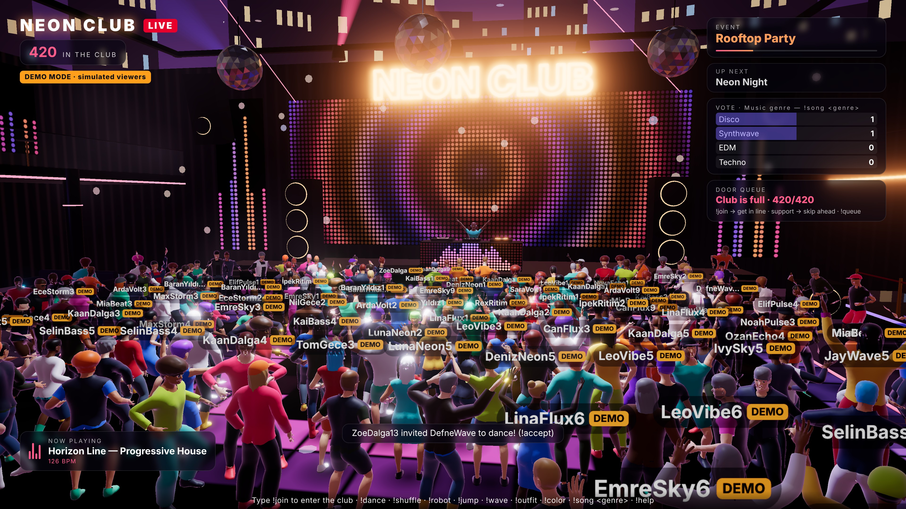 |
| Retro Disco from above | Rooftop Party |
| 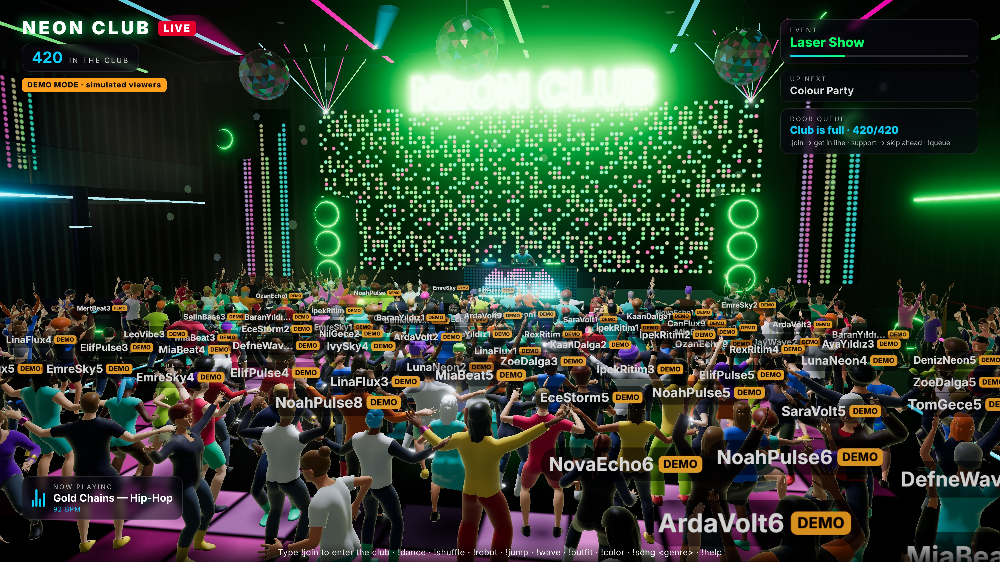 | 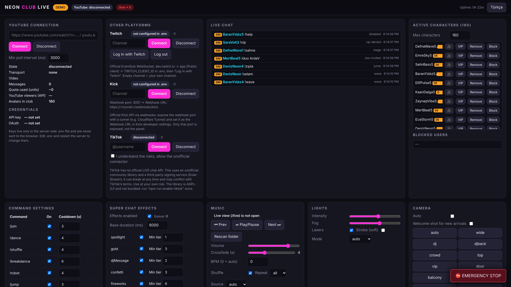 |
| Laser Show | Admin panel |
| 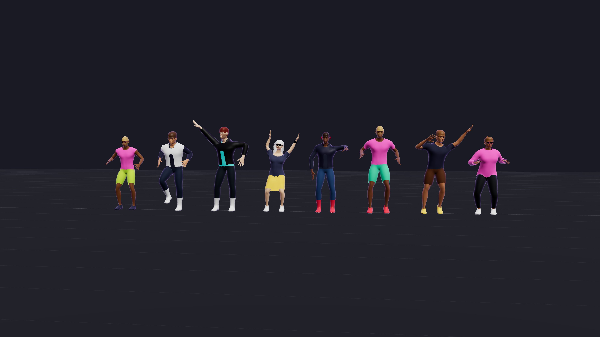 | 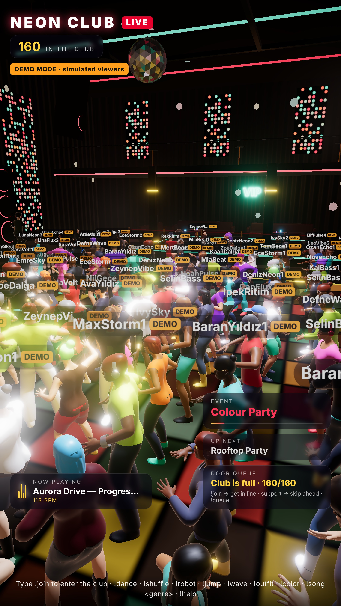 |
| Character variety | Vertical 9:16 output |

## 2. Requirements

* Windows 11 (Linux / macOS work for development)
* **Node.js 22.13 or newer** (uses the built-in `node:sqlite`) – https://nodejs.org
* **Git** – https://git-scm.com
* OBS Studio 30+
* Chrome or Edge
* Designed and tuned for: Intel Arc B580 12 GB, Ryzen 5 5600, 16 GB RAM (see [benchmark](#12-performance-and-benchmark))

## 3. Install and start

**Windows (PowerShell):**

```powershell
cd $HOME\Desktop
git clone https://github.com/samuilibo/neon-club-live.git
cd neon-club-live
.\setup.bat        # installs dependencies, creates .env, builds
.\start.bat        # starts the server and opens the admin panel
```

Or double-click `setup.bat`, then `start.bat`.

* Admin panel: `http://localhost:3000/admin`
* Stream output: `http://localhost:3000/live`

Edit settings with `notepad .env` (see [`.env.example`](.env.example)). Development mode with hot reload:
`npm run dev`. Linux / macOS: `./setup.sh && npm start`.

## 4. Connect YouTube

**API key (once):**

1. https://console.cloud.google.com → create a project.
2. *APIs & Services → Library* → enable **YouTube Data API v3**.
3. *Credentials → Create credentials → API key* → restrict it to YouTube Data API v3.
4. Put it into `.env`: `YOUTUBE_API_KEY=...`, then restart the server.

**Every stream:**

1. YouTube Studio → *Create → Go live*. Choose *Unlisted* for tests.
2. Start streaming from OBS.
3. Copy the stream link (`youtube.com/live/…`, `youtube.com/watch?v=…` or `youtu.be/…`).
4. Paste it into the admin panel → **YouTube connection** → **Connect**.

If your channel has never streamed, enabling live streaming can take up to 24 hours.

**What the server does (official API only):**

* video id → `videos.list(part=snippet,liveStreamingDetails)` → `activeLiveChatId`
* `liveChatMessages.streamList` (gRPC, low latency) when `YOUTUBE_USE_GRPC=1`, automatic fall-back to
  `liveChatMessages.list` polling that respects `pollingIntervalMillis`
* reads `id`, `snippet`, `authorDetails`; identity is the **channel id**, never the display name
* every message id is de-duplicated in SQLite; the `nextPageToken` is stored so a restart continues where it stopped
* messages from before the connection are marked historical – **old Super Chats never replay**
* reconnects with exponential back-off (1 s → 60 s); waits 15 min when the quota is used up; stream end and
  disabled chat are detected and shown in the panel
* API keys and tokens stay in the server process (`.env`) and are never sent to a browser or written to logs

**Quota:** a `list` call costs ~5 units. The free daily quota (10,000 units) lasts about 1.5–2 h when polling every
3 s. Raise *Min poll interval* in the panel (e.g. 6,000 ms ≈ 3.5 h) or request more quota from Google.

**OAuth (optional):** if key-only access is refused, create an OAuth client of type *Desktop app*, put its id and
secret into `.env`, run `node tools/oauth.mjs`, approve read-only access and paste the printed refresh token into `.env`.

> The gRPC `streamList` path follows Google's published interface definition
> (`server/youtube/proto/stream_list.proto`) and is unit-tested with a mocked transport. If it fails on your account,
> the server logs a warning and switches to polling automatically.

## 5. Twitch, Kick and TikTok

All platforms can run at the same time as YouTube and share one club. Identities stay separate (`tw:`, `kick:`,
`tt:`), every avatar has a small platform colour dot, and banners name the platform. All commands work everywhere.

| | Twitch | Kick | TikTok |
| --- | --- | --- | --- |
| API | **official** EventSub WebSocket | **official** Kick Public API (webhooks) | **unofficial** community library |
| Needs | `TWITCH_CLIENT_ID` + log in from the panel | `KICK_CLIENT_ID` / `KICK_CLIENT_SECRET` + a tunnel | `npm run enable-tiktok` + opt-in tick box |
| Paid events | Bits, subs, resubs, gift subs | KICKs, subs, renewals, gift subs | gifts (streaks counted once) |

**Twitch.** Create an application at https://dev.twitch.tv/console (Client Type *Public*, redirect URL
`http://localhost`) and put its id into `TWITCH_CLIENT_ID`. Panel → *Other platforms* → **Log in with Twitch** shows a
code; open the link (works on a phone), enter the code and approve read-chat access. Type a channel (empty = your
own) and press **Connect**. The token is stored in the local database and refreshed automatically. No public URL needed.

**Kick.** Kick only delivers events to a public HTTPS webhook. The server opens a separate webhook-only port
(`KICK_WEBHOOK_PORT`, default 3001); the panel and `/live` are never exposed through it.

1. kick.com → *Settings → Developer* (two-factor authentication required) → **Create App**; copy Client ID and Secret
   into `.env` as `KICK_CLIENT_ID` / `KICK_CLIENT_SECRET`.
2. Start a tunnel, for example Cloudflare: `winget install --id Cloudflare.cloudflared`, then
   `cloudflared tunnel --url http://localhost:3001`.
3. In your Kick app enable webhooks and set **Webhook URL** to `https://<generated-name>.trycloudflare.com/webhooks/kick`.
   (A quick tunnel's address changes every start; a named tunnel keeps it.)
4. Restart the server, type your channel name in the panel and press **Connect**. The status shows *waiting* until
   the first webhook arrives. Every webhook is verified with Kick's RSA signature.

**TikTok.** TikTok has **no official API for LIVE chat**. The optional connector uses the community library
`tiktok-live-connector`, which relies on the third-party Euler Stream signing service. It is reverse-engineered, can
break or be rate-limited at any time and may conflict with TikTok's terms of service. It is **off** until you tick
*"I understand the risks…"* in the panel. The library is **AGPL-3.0** licensed and therefore not bundled: install it
with `npm run enable-tiktok` (again after every `setup.bat` / `npm ci`).

> The three connectors follow the platforms' documentation and are covered by tests with mocked servers, but they
> could not be tried against the real services during development. Watch the panel status and logs on your first stream.

## 6. Chat commands

| English | Turkish | What it does |
| --- | --- | --- |
| `!join` | `!katıl` | enter the club (one avatar per account); when full: join the door queue |
| `!queue` | `!sıra` | show your place in the door queue |
| `!dance [style]` | `!dans [tür]` | random dance or a style: `hiphop`, `shuffle`, `break`, `robot`, `house`, `disco`, `techno`, `trance`, `slow`, `90s` |
| `!shuffle` `!breakdance` `!robot` | | dance styles |
| `!jump` `!wave` `!clap` | `!zıpla` `!selam` `!alkış` | short gestures |
| `!sit` / `!floor` | `!otur` / `!pist` | sit in the lounge (or VIP) / back to the dance floor |
| `!outfit` `!color` | `!kıyafet` `!renk` | new outfit / new colours (remembered) |
| `!vip` | `!vip` | VIP area (members, moderators, supporters, or granted in the panel) |
| `!stage` | `!sahne` | dance on stage for 45 s (4 places) |
| `!camera` | `!kamera` | close-up of your avatar (shared cooldown) |
| `!song <genre>` | `!müzik <tür>` | vote for the next music genre |
| `!event <no>` | `!etkinlik <no>` | vote for the next event while a vote is open |
| `!duo <name>` / `!accept` | `!duo <isim>` / `!kabul` | invite someone to a couple dance / accept |
| `!leave` | `!çık` | leave the club (or the queue) |
| `!help` | `!yardım` | show the command list on stream |

Each command has a per-user cooldown and an on/off switch in the panel. Repeats and floods (60 s mute), profanity and
inappropriate display names (replaced with `MisafirNNNN`) are filtered; add your own words with `BAD_WORDS` in `.env`.

## 7. Capacity, balcony and door queue

* **Up to 1,510 avatars** (panel → *Max characters*): ~270 roomy places on the LED floor (all dances), ~550 packed
  places around it, ~680 on the **balcony** (reached by the stairs on the south side), plus VIP, lounge and stage.
  Packed places only use compact dances, so neighbours never touch.
* The ~50–220 avatars nearest the camera (depends on the quality preset) are full skinned characters with name
  tags; everyone else is drawn by the GPU crowd (dances pre-baked into textures, one instanced draw call per body
  type). Both use the same beat clock, so switching between them is invisible.
* At most 40 people walk through the club at once; others wait at the door for a moment.
* **Door queue** when the club is full: `!join` puts you in line (first come, first served). By default, viewers who
  donate while waiting move ahead of the free queue, ordered by the **total amount** they donated while waiting
  (approximate value; YouTube uses its own tier table). On stream a card shows *Club full · N/N*, how many are waiting,
  the first five (★ = priority, amount in the platform's own unit) and how to join.
* Panel → Super Chat → *Door queue*: switch priority **off** (plain first-come queue), or let **one free viewer in after
  every N priority entries**.
* Please check each platform's rules on rewarding paid messages with perks before using priority on a monetised stream.

## 8. Super Chats, gifts and memberships

Thank people visibly; perks are cosmetic (plus optional queue priority when the club is full). No randomness, no
betting, no money leaderboard, no "send X to unlock Y" goal.

**Effect ladder** (YouTube tiers; other platforms converted approximately: 100 Bits ≈ $1, Twitch sub ≈ $5 / $10 / $25,
1 KICK ≈ $0.01, Kick sub ≈ $5, 1 TikTok coin ≈ $0.013). Each step adds to the previous one:

| Tier | ≈ value | What happens |
| --- | --- | --- |
| below 1 | < $1 | nothing on stream; small gifts from one person are **added up for 2 min** and fire once they reach $1 |
| 1 | $1 | thank-you banner (name + amount exactly as reported) + follow spot |
| 2 | $2 | + thank-you on the LED wall behind the DJ |
| 3 | $5 (memberships, subs) | + golden avatar + confetti |
| 4 | $10 | + **close-up camera** + special dance |
| 5 | $20 | + club-wide light show |
| 6+ | $50+ | + indoor fireworks + 45 s on stage |

* The banner always shows the original amount and currency / unit ("₺1.500,00", "500 Bits", "Rose ×5 (5 coins)").
* Supporters get **temporary VIP** (default 60 min) and, if not inside yet, **walk in automatically** when there is room.
* Effects never overlap; during gift bombs small ones are merged into one **combo banner**.
* Paid messages pass the strictest filter (profanity, links, @mentions removed; can be switched off).
* Old or duplicated events never replay; the panel has **Skip effect**, **Clear queue** and an **emergency stop**.
* If you lock the camera to a fixed shot in the panel, effects do not change it; keep the camera on **Auto** for close-ups.
* Demo events are labelled **SIMULATION** and are refused while a real stream is connected.

## 9. Music

Put **only music you have the rights to stream and monetise** into `music/` (MP3, WAV, OGG, M4A, AAC, FLAC, OPUS, WEBM; sub-folders = genres).
Do not rip audio from Spotify or YouTube. The panel has playlist, shuffle, repeat, volume, crossfade, next/previous and
genre selection. When a genre has no files, an **original built-in generative synthesiser** plays it (EDM, Techno,
Deep House, Progressive, Trance, Hip-hop, Disco, Synthwave, Turkish electronic with the Hicaz scale).

Web Audio analysis provides bass / mid / treble, a 64-band spectrum, level, beat detection and BPM estimation.
Dances, LEDs, lasers and speakers follow the beat. Use the panel's *BPM* field to force a tempo and **Tests → sync**
to check the beat grid with a metronome.

On phones and in normal browser tabs, tap the page once to start the audio (browser autoplay rule); OBS needs no tap.

## 10. OBS

**Browser Source (recommended)**

1. *Sources → + → Browser*: URL `http://localhost:3000/live`, width **1920**, height **1080**
   (vertical: `http://localhost:3000/live?layout=portrait`, 1080 × 1920).
2. Tick **Control audio via OBS** – the club audio gets its own mixer channel.
3. *Settings → Advanced → Sources*: keep **Browser Source Hardware Acceleration** on.
4. *Settings → Video*: 1920×1080, 60 FPS (or 30). Encoder on Intel Arc: **QuickSync AV1 / H.264**.

**4K (3840×2160) or 1440p.** Set OBS *Base / Output resolution* and the browser source to the same size. The scene and
the on-stream HUD scale with the source size. Dynamic resolution (panel → Graphics) lowers the internal render scale
(down to half) when FPS drops, so the output stays 4K and smooth. Run `npm run benchmark -- 300 high` with the 4K source
open: if it stays below ~30 FPS on your GPU, 2560×1440 is the better choice. A 4K stream also needs a fast upload
(roughly 20–50 Mbps depending on the encoder; AV1 on Intel Arc needs the least).

**Alternative: window capture.** If the browser source has GPU problems, run `live-window.bat` (or
`live-window.bat portrait`): Edge / Chrome opens in a frameless window with autoplay on. In OBS add **Window Capture**
(*Windows 10 (1903 and up)* method) and **Application Audio Capture** for the browser. Keep the window un-minimised.

**Audio:** use either the browser source audio or application audio capture – not Desktop Audio for the same signal
as well (double audio / echo).

## 11. Control from your phone (Tailscale)

1. Install Tailscale on the PC and the phone, log in with the same account.
2. In `.env` set `HOST=0.0.0.0` and a long random `ADMIN_TOKEN=...`, restart the server.
3. Allow port 3000 in the Windows firewall for **private networks** only when asked.
4. Find the PC's address: `tailscale ip -4`.
5. On the phone open `http://<tailscale-ip>:3000/admin?token=<your token>`.

You can also open `http://<tailscale-ip>:3000/live?quality=low` on the phone, but then the **phone** renders the 3D
scene itself. To see what viewers get, start an unlisted test stream and watch it in the YouTube app.
Do not forward port 3000 on your router: the panel uses plain HTTP.

## 12. Performance and benchmark

Quality presets **low / medium / high / ultra** change render scale, anti-aliasing, shadows, real spot lights, beams,
lasers, haze, LOD distances, the number of full characters and their animation rate. Implemented: 4 character LODs,
animation LOD, frustum culling, GPU-instanced crowd with baked animation textures, pooled characters, instanced props,
dynamic resolution, a NaN-safe bloom chain and explicit disposal of everything an avatar owns.

**Measure, don't guess:** open `/live` in OBS or Edge on your PC, then panel → **Run benchmark**, or
`npm run benchmark -- 1500 high`. It fixes the resolution, cycles five camera shots for 6 s each and reports average
FPS, 5 % / 1 % lows, draw calls and triangles (saved in `bench-results/`). This repository claims no FPS numbers:
development ran on a machine without a GPU.

## 13. Demo mode and tests

Panel → **Demo & tests**: 10 / 50 / 100 / 300 / 1,500 simulated viewers, extra bots, custom chat line, simulated
Super Chat of any tier (amounts match the tier in USD / EUR / TRY), disconnect simulation, load tests, light /
animation / camera / music-sync tests, confetti, fireworks, DJ message. Everything is labelled as simulation.

```bash
npm test             # unit tests (commands, moderation, queue, support policy, platforms, YouTube, navigation)
npm run smoke        # headless end-to-end run (demo crowd, effects, events, resource-leak check)
npm run benchmark    # measured FPS on this PC (needs /live open)
npm run typecheck
node tools/screenshots.mjs club|full|extra   # re-render the 4K README screenshots (server must run)
```

Animation test page: `http://localhost:3000/viewer?clip=shuffle_run&n=6`

## 14. Characters and assets

Characters are generated by `tools/build_characters.py` from the **CC0** MakeHuman / MPFB2 base mesh, morph targets,
`game_engine` skeleton (53 bones) and skin weights. Clothes, hair, hats and accessories are generated procedurally;
all motions are original code. Details in [ASSET_LICENSES.md](ASSET_LICENSES.md). To rebuild:

```bash
git clone https://github.com/makehumancommunity/mpfb2
python3 tools/build_characters.py --mpfb ./mpfb2     # needs numpy + pillow
```

## 15. Project layout, contributing, licence

* Architecture: [ARCHITECTURE.md](ARCHITECTURE.md) · development log and known limitations: [PROGRESS.md](PROGRESS.md)
* Contributing: [CONTRIBUTING.md](CONTRIBUTING.md) · security: [SECURITY.md](SECURITY.md) · conduct: [CODE_OF_CONDUCT.md](CODE_OF_CONDUCT.md)
* Code: **MIT** ([LICENSE](LICENSE)). Assets: see [ASSET_LICENSES.md](ASSET_LICENSES.md).

Have a great stream! 🎶
