# NEON CLUB LIVE

[English](README.md) · **Türkçe**

Canlı yayınlar için açık kaynaklı, etkileşimli bir 3D gece kulübü. İzleyiciler **YouTube, Twitch, Kick veya TikTok**
canlı sohbetine `!katıl` (veya `!join`) yazınca kendilerine ait, iskeletli bir insan karakteri kapıdan içeri yürür,
boş bir yer bulur ve müziğin ritmine uyarak dans eder. Kulübe **1.510 kişiye kadar** sığar (dans pisti + balkon).
Her şey kendi bilgisayarında çalışır: bir Node.js sunucusu, OBS'in yakaladığı bir tarayıcı sayfası ve telefondan da
açılabilen bir yönetim paneli. Ücretli yapay zekâ servisi kullanılmaz.

* `/live` – tam ekran yayın görüntüsü (OBS'e eklenir)
* `/admin` – yönetim paneli (Türkçe / İngilizce), yayında görünmez

> Bu proje Google/YouTube, Twitch, Kick veya TikTok/ByteDance ile bağlantılı değildir ve onlar tarafından
> desteklenmemektedir. Ürün adları ilgili sahiplerinin ticari markalarıdır.


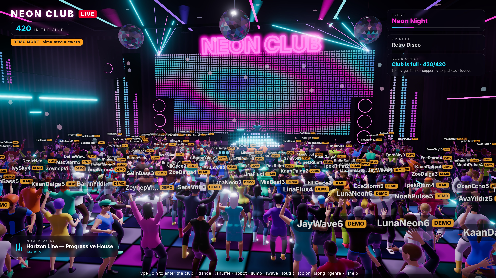

---

## İçindekiler

1. [Özellikler](#1-özellikler) · [Ekran görüntüleri](#ekran-görüntüleri)
2. [Gereksinimler](#2-gereksinimler)
3. [Kurulum ve başlatma](#3-kurulum-ve-başlatma)
4. [YouTube bağlantısı](#4-youtube-bağlantısı)
5. [Twitch, Kick ve TikTok](#5-twitch-kick-ve-tiktok)
6. [Sohbet komutları](#6-sohbet-komutları)
7. [Kapasite, balkon ve kapı sırası](#7-kapasite-balkon-ve-kapı-sırası)
8. [Super Chat, hediye ve üyelikler](#8-super-chat-hediye-ve-üyelikler)
9. [Müzik](#9-müzik)
10. [OBS](#10-obs)
11. [Telefondan kontrol (Tailscale)](#11-telefondan-kontrol-tailscale)
12. [Performans ve benchmark](#12-performans-ve-benchmark)
13. [Demo modu ve testler](#13-demo-modu-ve-testler)
14. [Karakterler ve varlıklar](#14-karakterler-ve-varlıklar)
15. [Proje yapısı, katkı, lisans](#15-proje-yapısı-katkı-lisans)

---

## 1. Özellikler

* **3D kulüp** (Three.js / WebGL 2): LED dans pisti, hareketli DJ'li DJ kabini, LED duvarlar, VIP alanı, lounge, bar,
  kırmızı halılı giriş, neon tabelalar, merdivenli balkon, hoparlörler, disko topları, lazerler, hareketli spotlar,
  sis, bloom. Işıklar, LED'ler ve lazerler ritme tepki verir.
* **İskeletli insan karakterleri** (CC0 MakeHuman taban modelinden): 8 vücut tipi, çok sayıda kıyafet, saç modeli,
  şapka, gözlük ve renk. Her izleyiciye kalıcı bir görünüm.
* **37 özgün hareket** (22 dans, grup koreografileri, çift dansı, yürüme, koşma, oturma, el hareketleri, DJ hareketleri);
  IK ile ayaklar yerde kayıp kaymaz, danslar müziğin ritmine kilitlidir.
* **Kalabalık sistemi**: iki katlı yol bulma, yer rezervasyonu (kimse iç içe geçmez), kameraya en yakın ~50–220 kişi tam
  detaylı karakter, diğerleri **GPU kalabalığı** ile toplu çizilir.
* **Canlı sohbet**: YouTube (resmi API), Twitch (resmi EventSub), Kick (resmi webhook), TikTok (isteğe bağlı, gayri resmi).
  Türkçe ve İngilizce komutlar, bekleme süreleri, spam / küfür / isim filtreleri, engelleme.
* **Destek efektleri**: teşekkür bandı, takip spotu, LED teşekkür, altın karakter, konfeti, yakın çekim, ışık gösterisi,
  havai fişek, sahne – hepsi kozmetik, sıralı, asla tekrar oynamaz.
* **Kapı sırası**: kulüp dolunca sıra; isteğe bağlı destekçi önceliği.
* **Otomatik kamera yönetmeni** (13 açı, 10–25 sn, yumuşak geçiş, duvar ve insan içinden geçmez).
* **Etkinlikler** (Neon Night, Retro Disco, Techno Festival, 90'lar, Dans Kapışması, Koreografi, DJ Show, Lazer Gösterisi,
  Renk Partisi, Rooftop) – sohbet oylamasıyla seçilir.
* **Müzik çalar**: kendi dosyaların + özgün, yerleşik üretken synth; ritim / BPM algılama.
* **Yönetim paneli** Türkçe ve İngilizce; Tailscale ile telefondan da açılabilir.
* **Demo modu**: 10 – 1.500 simüle izleyici, açıkça "simülasyon" olarak işaretli.

## Ekran görüntüleri

Tüm görüntüler 3840×2160, demo modunda (simüle izleyiciler, DEMO etiketli) uygulamanın kendisi tarafından çizildi.

| | |
| --- | --- |
|  | 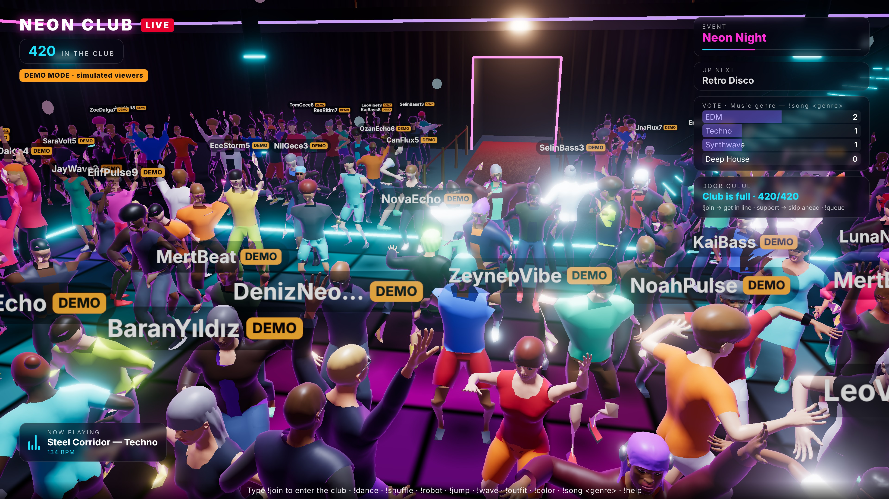 |
| Ana pist – Neon Night | Kalabalık etrafında dönen kamera |
| 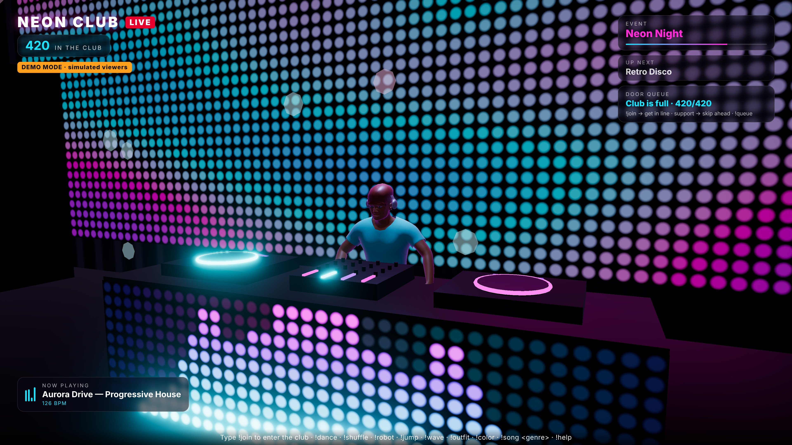 | 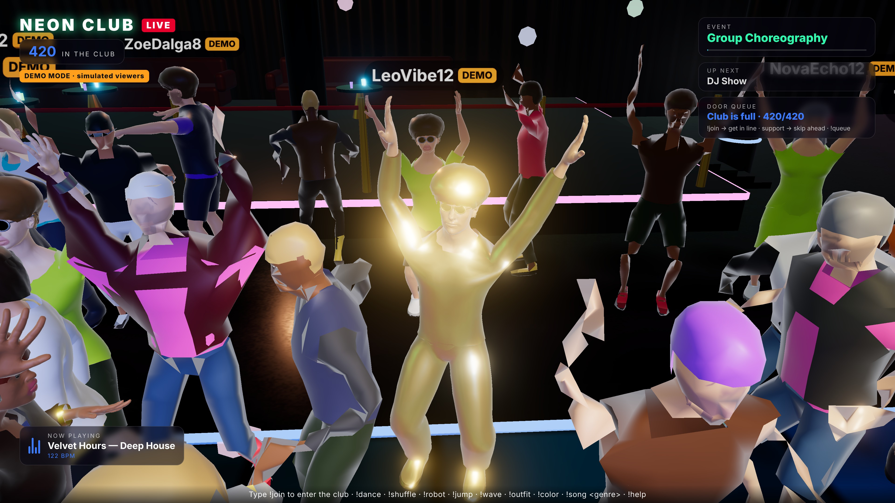 |
| DJ kabini | Destekçi yakın çekimi (simüle Super Chat) |
| 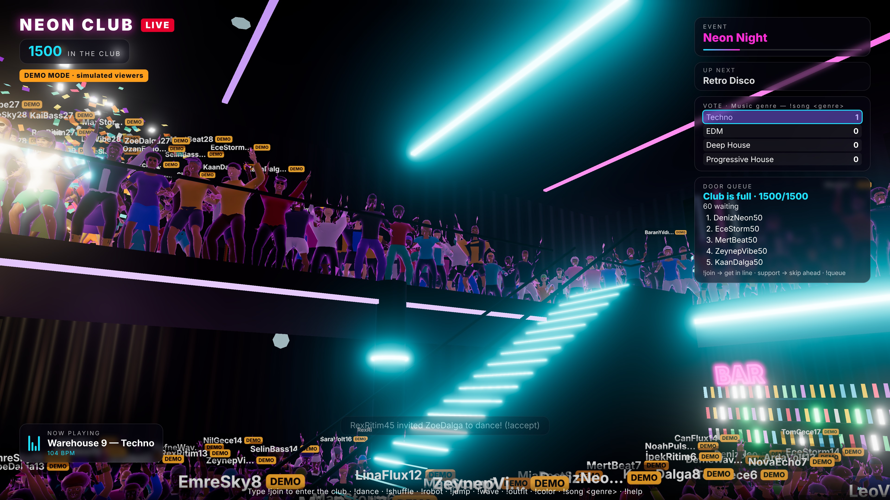 | 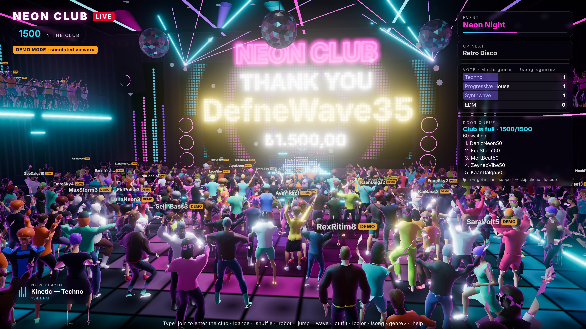 |
| 1.500 kişi – balkon | Dolu kulüp ve kapı sırası |
| 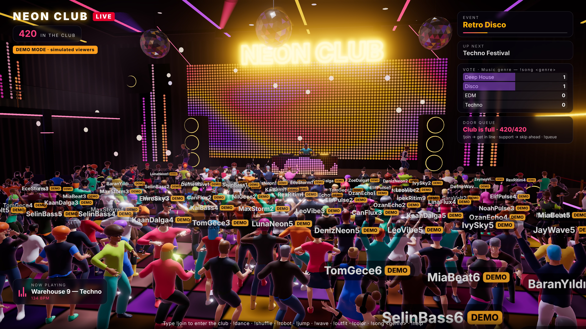 | 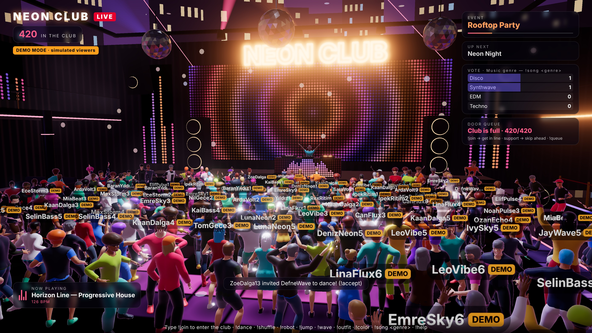 |
| Retro Disco, kuşbakışı | Rooftop Party |
| 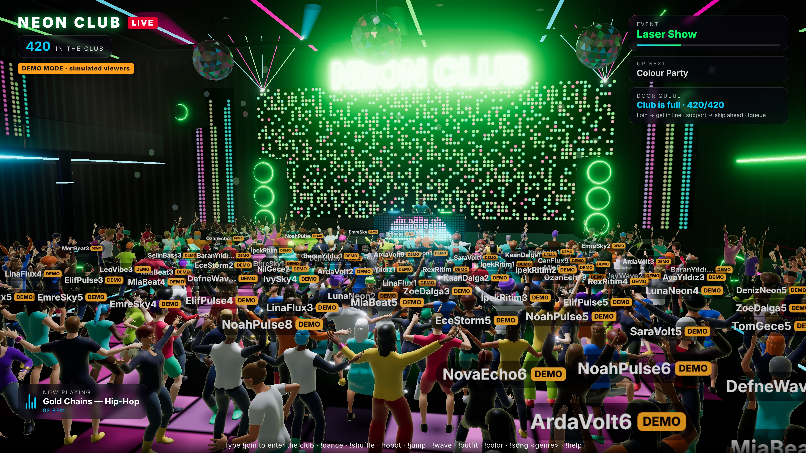 | 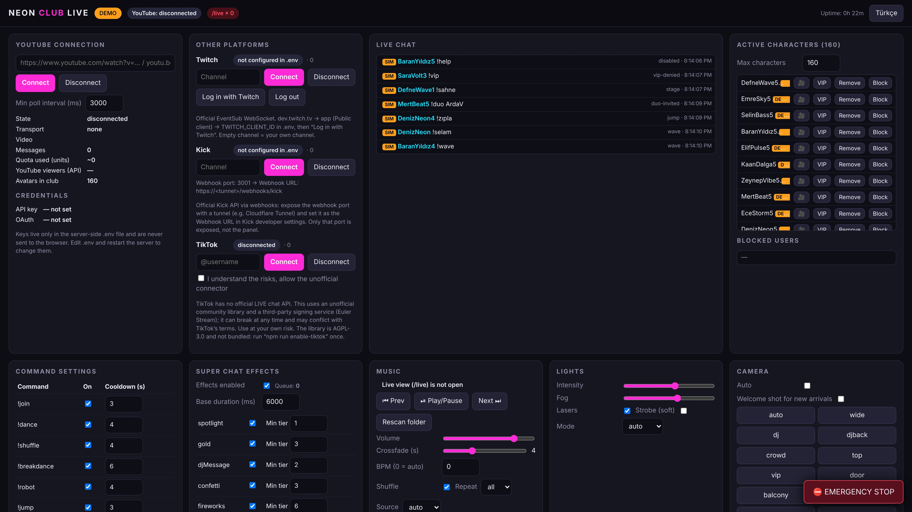 |
| Lazer Gösterisi | Yönetim paneli |
| 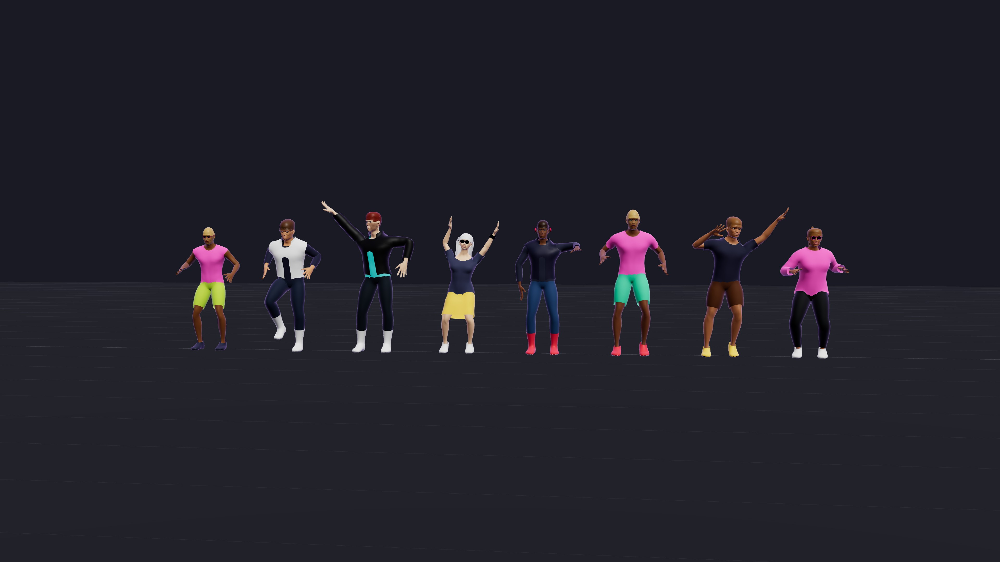 | 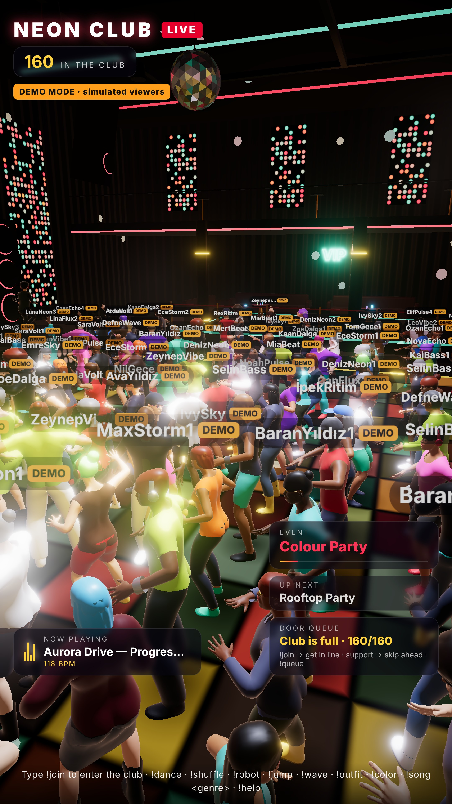 |
| Karakter çeşitliliği | Dikey 9:16 yayın |

## 2. Gereksinimler

* Windows 11 (geliştirme için Linux / macOS da olur)
* **Node.js 22.13 veya üstü** (yerleşik `node:sqlite` kullanılır) – https://nodejs.org
* **Git** – https://git-scm.com
* OBS Studio 30+
* Chrome veya Edge
* Hedeflenen donanım: Intel Arc B580 12 GB, Ryzen 5 5600, 16 GB RAM ([benchmark](#12-performans-ve-benchmark) bölümüne bakın)

## 3. Kurulum ve başlatma

**Windows (PowerShell):**

```powershell
cd $HOME\Desktop
git clone https://github.com/samuilibo/neon-club-live.git
cd neon-club-live
.\setup.bat        # bağımlılıkları kurar, .env oluşturur, derler
.\start.bat        # sunucuyu başlatır ve yönetim panelini açar
```

İstersen `setup.bat` ve ardından `start.bat` dosyalarına çift tıkla.

* Yönetim paneli: `http://localhost:3000/admin`
* Yayın görüntüsü: `http://localhost:3000/live`

Ayarları `notepad .env` ile düzenle ([`.env.example`](.env.example) dosyasında açıklamalar var). Anında yenilenen
geliştirme modu: `npm run dev`. Linux / macOS: `./setup.sh && npm start`.

## 4. YouTube bağlantısı

**API anahtarı (bir kere):**

1. https://console.cloud.google.com → yeni proje oluştur.
2. *APIs & Services → Library* → **YouTube Data API v3**'ü etkinleştir.
3. *Credentials → Create credentials → API key* → anahtarı YouTube Data API v3 ile sınırla.
4. `.env` içine yaz: `YOUTUBE_API_KEY=...`, sunucuyu yeniden başlat.

**Her yayında:**

1. YouTube Studio → *Oluştur → Canlı yayına başla*. Test için *Liste dışı* seç.
2. OBS'ten yayını başlat.
3. Yayın bağlantısını kopyala (`youtube.com/live/…`, `youtube.com/watch?v=…` veya `youtu.be/…`).
4. Panelde **YouTube bağlantısı** kutusuna yapıştır → **Bağlan**.

Kanalında hiç canlı yayın yapmadıysan canlı yayının etkinleşmesi 24 saate kadar sürebilir.

**Sunucunun yaptıkları (yalnızca resmi API):**

* video kimliği → `videos.list(part=snippet,liveStreamingDetails)` → `activeLiveChatId`
* `YOUTUBE_USE_GRPC=1` iken düşük gecikmeli `liveChatMessages.streamList` (gRPC); olmazsa otomatik olarak
  `pollingIntervalMillis` değerine uyan `liveChatMessages.list` sorgulamasına geçer
* `id`, `snippet`, `authorDetails` alanlarını okur; kimlik **kanal kimliğidir**, değişebilen kullanıcı adı değil
* her mesaj kimliği SQLite'ta tekilleştirilir; `nextPageToken` saklanır, yeniden başlatınca kalınan yerden devam edilir
* bağlantıdan önceki mesajlar "geçmiş" sayılır – **eski Super Chat'ler asla tekrar oynamaz**
* bağlantı koparsa üstel bekleme ile (1 sn → 60 sn) yeniden bağlanır; kota bitince 15 dk bekler; yayın bitişi ve
  kapalı sohbet algılanıp panelde gösterilir
* API anahtarları ve token'lar sunucuda (`.env`) kalır; tarayıcıya gönderilmez, kayıtlara yazılmaz

**Kota:** bir `list` çağrısı ~5 birim. Ücretsiz günlük kota (10.000 birim) 3 saniyede bir sorguda yaklaşık 1,5–2 saat
yeter. Paneldeki *Min. sorgu aralığı*'nı büyüt (ör. 6.000 ms ≈ 3,5 saat) veya Google'dan ek kota iste.

**OAuth (isteğe bağlı):** yalnız anahtarla erişim reddedilirse *Desktop app* türünde bir OAuth istemcisi oluştur,
kimlik ve gizli anahtarı `.env`'ye yaz, `node tools/oauth.mjs` çalıştır, salt okunur erişimi onayla ve çıkan
refresh token'ı `.env`'ye yapıştır.

> gRPC `streamList` yolu Google'ın yayımladığı arayüz tanımına (`server/youtube/proto/stream_list.proto`) göre yazıldı ve
> sahte bağlantıyla test edildi. Hesabında çalışmazsa sunucu uyarı yazar ve kendiliğinden sorgulamaya geçer.

## 5. Twitch, Kick ve TikTok

Tüm platformlar YouTube ile aynı anda çalışabilir ve aynı kulübü paylaşır. Kimlikler ayrı tutulur (`tw:`, `kick:`, `tt:`),
her karakterde küçük bir platform renk noktası vardır, teşekkür bantlarında platform adı yazar. Tüm komutlar her yerde çalışır.

| | Twitch | Kick | TikTok |
| --- | --- | --- | --- |
| API | **resmi** EventSub WebSocket | **resmi** Kick Public API (webhook) | **gayri resmi** topluluk kütüphanesi |
| Gerekenler | `TWITCH_CLIENT_ID` + panelden giriş | `KICK_CLIENT_ID` / `KICK_CLIENT_SECRET` + tünel | `npm run enable-tiktok` + onay kutusu |
| Ücretli olaylar | Bits, abonelik, yenileme, hediye abonelik | KICKs, abonelik, yenileme, hediye abonelik | hediyeler (seriler bir kez sayılır) |

**Twitch.** https://dev.twitch.tv/console adresinde uygulama oluştur (Client Type *Public*, yönlendirme adresi
`http://localhost`) ve kimliğini `TWITCH_CLIENT_ID` olarak yaz. Panel → *Diğer platformlar* → **Twitch ile giriş** bir kod
gösterir; bağlantıyı aç (telefonda da olur), kodu gir ve sohbet okuma iznini onayla. Kanal adını yaz (boşsa kendi kanalın)
ve **Bağlan**'a bas. Token yerel veritabanında saklanır ve kendiliğinden yenilenir. Herkese açık adres gerekmez.

**Kick.** Kick olayları yalnızca internetten erişilebilen bir HTTPS webhook adresine gönderir. Sunucu sadece webhook için
ayrı bir port açar (`KICK_WEBHOOK_PORT`, varsayılan 3001); panel ve `/live` bu yoldan asla dışarı açılmaz.

1. kick.com → *Ayarlar → Developer* (iki adımlı doğrulama gerekir) → **Create App**; Client ID ve Secret'ı `.env`'ye
   `KICK_CLIENT_ID` / `KICK_CLIENT_SECRET` olarak yaz.
2. Bir tünel başlat, örneğin Cloudflare: `winget install --id Cloudflare.cloudflared`, ardından
   `cloudflared tunnel --url http://localhost:3001`.
3. Kick uygulamanda webhook'u aç ve **Webhook URL** olarak `https://<oluşan-ad>.trycloudflare.com/webhooks/kick` yaz.
   (Hızlı tünelin adresi her başlatışta değişir; kalıcı adres için "named tunnel" kur.)
4. Sunucuyu yeniden başlat, panelde kanal adını yaz ve **Bağlan**'a bas. İlk webhook gelene kadar durum *waiting* görünür.
   Her webhook Kick'in RSA imzasıyla doğrulanır.

**TikTok.** TikTok'un **canlı sohbet için resmi bir API'si yok**. İsteğe bağlı bağlayıcı, üçüncü taraf Euler Stream imza
servisini kullanan topluluk kütüphanesi `tiktok-live-connector` ile çalışır. Tersine mühendislikle yapılmıştır; her an
bozulabilir veya sınırlanabilir ve TikTok kurallarıyla çelişebilir. Panelde *"Riskleri anladım…"* kutusunu işaretleyene kadar
**kapalıdır**. Kütüphane **AGPL-3.0** lisanslı olduğu için projeye dahil değildir: `npm run enable-tiktok` ile kur (her
`setup.bat` / `npm ci` sonrasında tekrar).

> Bu üç bağlayıcı platformların belgelerine göre yazıldı ve sahte sunucularla test edildi, ancak geliştirme sırasında gerçek
> servislerle denenemedi. İlk yayında paneldeki durumu ve kayıtları takip et.

## 6. Sohbet komutları

| Türkçe | İngilizce | Ne yapar |
| --- | --- | --- |
| `!katıl` | `!join` | kulübe gir (hesap başına bir karakter); kulüp doluysa kapı sırasına gir |
| `!sıra` | `!queue` | kapı sırasındaki yerini göster |
| `!dans [tür]` | `!dance [style]` | rastgele dans veya tür: `hiphop`, `shuffle`, `break`, `robot`, `house`, `disco`, `techno`, `trance`, `slow`, `90s` |
| `!shuffle` `!breakdance` `!robot` | | dans türleri |
| `!zıpla` `!selam` `!alkış` | `!jump` `!wave` `!clap` | kısa hareketler |
| `!otur` / `!pist` | `!sit` / `!floor` | lounge'da (veya VIP'de) otur / piste dön |
| `!kıyafet` `!renk` | `!outfit` `!color` | yeni kıyafet / yeni renkler (hatırlanır) |
| `!vip` | `!vip` | VIP alanı (üyeler, moderatörler, destekçiler veya panelden izin verilenler) |
| `!sahne` | `!stage` | 45 sn sahnede dans (4 kişilik) |
| `!kamera` | `!camera` | karakterine yakın çekim (ortak bekleme süresi) |
| `!müzik <tür>` | `!song <genre>` | sonraki müzik türü için oy ver |
| `!etkinlik <no>` | `!event <no>` | oylama açıkken sonraki etkinliğe oy ver |
| `!duo <isim>` / `!kabul` | `!duo <name>` / `!accept` | birini çift dansına davet et / kabul et |
| `!çık` | `!leave` | kulüpten (veya sıradan) çık |
| `!yardım` | `!help` | komut listesini yayında göster |

Her komutun kişi başı bekleme süresi ve panelde aç/kapa anahtarı vardır. Tekrar ve mesaj yağmuru (60 sn susturma), küfür ve
uygunsuz kullanıcı adları (`MisafirNNNN` ile değiştirilir) filtrelenir; kendi kelimelerini `.env`'de `BAD_WORDS` ile ekle.

## 7. Kapasite, balkon ve kapı sırası

* **1.510 kişiye kadar** (panel → *Maks. karakter*): LED pistte ~270 geniş yer (tüm danslar), çevresinde ~550 sıkışık yer,
  **balkonda** ~680 yer (güney taraftaki merdivenden çıkılır), ayrıca VIP, lounge ve sahne. Sıkışık yerlerde sadece
  kompakt danslar yapılır, böylece yan yana duranlar birbirine değmez.
* Kameraya en yakın ~50–220 kişi (kalite ayarına göre) isim etiketli tam detaylı karakterdir; diğerleri GPU kalabalığıyla
  çizilir (danslar dokulara önceden pişirilmiş, her vücut tipi tek çizim çağrısı). İkisi aynı ritim saatini kullandığı için
  aralarındaki geçiş fark edilmez.
* Aynı anda en fazla 40 kişi kulüpte yürür; diğerleri kapıda kısa süre bekler.
* **Kapı sırası**: kulüp doluyken `!katıl` sıraya alır (önce gelen önce girer). Varsayılan olarak beklerken bağış yapanlar
  ücretsiz sıranın önüne geçer ve beklerken yaptıkları **toplam miktara** göre sıralanır (yaklaşık değer; YouTube kendi
  seviye tablosunu kullanır). Yayında bir kart *Kulüp dolu · N/N*, bekleyen sayısını, ilk beş kişiyi (★ = öncelikli,
  tutar platformun kendi biriminde) ve nasıl sıraya girileceğini gösterir.
* Panel → Super Chat → *Kapı sırası*: önceliği **kapat** (düz sıra) veya **her N öncelikli girişten sonra 1 ücretsiz** kişi al.
* Para kazanılan yayında önceliği kullanmadan önce her platformun ücretli mesajlara ayrıcalık tanıma kurallarını kontrol et.

## 8. Super Chat, hediye ve üyelikler

Destekçilere görünür şekilde teşekkür edilir; ayrıcalıklar kozmetiktir (artı kulüp doluyken isteğe bağlı sıra önceliği).
Rastgelelik, bahis, para sıralaması veya "şu kadar gönder, şu açılsın" hedefi yoktur.

**Efekt merdiveni** (YouTube seviyeleri; diğer platformlar yaklaşık çevrilir: 100 Bits ≈ 1 $, Twitch aboneliği ≈ 5 / 10 / 25 $,
1 KICK ≈ 0,01 $, Kick aboneliği ≈ 5 $, 1 TikTok jetonu ≈ 0,013 $). Her basamak öncekinin üstüne eklenir:

| Seviye | ≈ değer | Ne olur |
| --- | --- | --- |
| 1'in altı | < 1 $ | yayında bir şey olmaz; aynı kişinin küçük hediyeleri **2 dk boyunca toplanır**, 1 $'a ulaşınca tetiklenir |
| 1 | 1 $ | teşekkür bandı (isim + platformun bildirdiği tutar) + takip spotu |
| 2 | 2 $ | + DJ'in arkasındaki LED duvarda teşekkür |
| 3 | 5 $ (üyelik, abonelik) | + altın karakter + konfeti |
| 4 | 10 $ | + **yakın çekim kamera** + özel dans |
| 5 | 20 $ | + tüm kulüpte ışık gösterisi |
| 6+ | 50 $+ | + kapalı alan havai fişekleri + 45 sn sahne |

* Bant her zaman orijinal tutarı ve para birimini / birimi gösterir ("₺1.500,00", "500 Bits", "Rose ×5 (5 coins)").
* Destekçiler **geçici VIP** (varsayılan 60 dk) alır; kulüpte değilse ve yer varsa **otomatik içeri yürür**.
* Efektler üst üste binmez; hediye yağmurunda küçükler tek bir **toplu teşekkür bandında** birleşir.
* Ücretli mesajlar en sıkı filtreden geçer (küfür, link, @etiket kaldırılır; tamamen kapatılabilir).
* Eski veya tekrar gelen olaylar oynamaz; panelde **Efekti atla**, **Kuyruğu temizle** ve **acil durdurma** vardır.
* Panelde kamerayı sabit bir açıya kilitlersen efektler kamerayı değiştirmez; yakın çekim için kamerayı **Otomatik**'te bırak.
* Demo olayları **SİMÜLASYON** olarak işaretlenir ve gerçek yayın bağlıyken reddedilir.

## 9. Müzik

`music/` klasörüne **yalnızca yayınlama ve para kazanma hakkın olan müzikleri** koy (MP3, WAV, OGG; alt klasörler = türler).
Spotify veya YouTube'dan müzik çekme. Panelde çalma listesi, karıştırma, tekrar, ses, crossfade, ileri/geri ve tür seçimi var.
Bir tür için dosya yoksa **özgün, yerleşik üretken synth** o türü çalar (EDM, Techno, Deep House, Progressive, Trance,
Hip-hop, Disco, Synthwave, Hicaz makamıyla Türkçe elektronik).

Web Audio analizi bass / mid / treble, 64 bantlı spektrum, ses seviyesi, ritim algılama ve BPM tahmini sağlar. Danslar,
LED'ler, lazerler ve hoparlörler ritmi takip eder. Panelin *BPM* alanıyla tempo sabitlenebilir, **Testler → sync** ile
metronom eşliğinde ritim kontrol edilebilir.

Telefonda ve normal tarayıcı sekmesinde sesi başlatmak için sayfaya bir kez dokun (tarayıcı kuralı); OBS'te gerekmez.

## 10. OBS

**Tarayıcı kaynağı (önerilen)**

1. *Kaynaklar → + → Tarayıcı*: URL `http://localhost:3000/live`, genişlik **1920**, yükseklik **1080**
   (dikey: `http://localhost:3000/live?layout=portrait`, 1080 × 1920).
2. **Sesi OBS üzerinden kontrol et** kutusunu işaretle – kulüp sesi ayrı bir mikser kanalı olur.
3. *Ayarlar → Gelişmiş → Kaynaklar*: **Tarayıcı kaynağı donanım hızlandırma** açık kalsın.
4. *Ayarlar → Video*: 1920×1080, 60 FPS (veya 30). Intel Arc'ta kodlayıcı: **QuickSync AV1 / H.264**.

**Alternatif: pencere yakalama.** Tarayıcı kaynağında GPU sorunu olursa `live-window.bat` (veya `live-window.bat portrait`)
çalıştır: Edge / Chrome çerçevesiz bir pencerede, otomatik oynatma açık şekilde açılır. OBS'e **Pencere Yakalama**
(*Windows 10 (1903 ve üstü)* yöntemi) ve tarayıcı için **Uygulama Ses Yakalama** ekle. Pencereyi küçültme.

**Ses:** ya tarayıcı kaynağının sesini ya da uygulama ses yakalamayı kullan; aynı sesi ayrıca Masaüstü Sesi'nden alma
(çift ses / yankı olur).

## 11. Telefondan kontrol (Tailscale)

1. Bilgisayara ve telefona Tailscale kur, aynı hesapla giriş yap.
2. `.env` içinde `HOST=0.0.0.0` ve uzun, rastgele bir `ADMIN_TOKEN=...` ayarla, sunucuyu yeniden başlat.
3. Windows güvenlik duvarı sorarsa 3000 portuna sadece **özel ağlar** için izin ver.
4. Bilgisayarın adresini öğren: `tailscale ip -4`.
5. Telefonda `http://<tailscale-ip>:3000/admin?token=<şifren>` adresini aç.

Telefonda `http://<tailscale-ip>:3000/live?quality=low` de açılabilir, ama o zaman 3D sahneyi **telefon** kendisi çizer.
İzleyicinin gördüğünü görmek için liste dışı bir test yayını açıp YouTube uygulamasından izle.
Modemde 3000 portunu dışarı açma: panel şifresiz HTTP kullanır.

## 12. Performans ve benchmark

**low / medium / high / ultra** kalite ayarları çözünürlük ölçeğini, kenar yumuşatmayı, gölgeleri, gerçek spot ışıklarını,
hüzmeleri, lazerleri, sisi, LOD mesafelerini, tam detaylı karakter sayısını ve animasyon hızlarını değiştirir. Uygulananlar:
4 karakter LOD'u, animasyon LOD'u, görüş alanı dışını çizmeme, pişirilmiş animasyon dokulu GPU kalabalığı, karakter havuzu,
toplu çizilen dekor, dinamik çözünürlük, NaN'a karşı korumalı bloom ve karakterin tüm kaynaklarının açıkça serbest bırakılması.

**Tahmin etme, ölç:** bilgisayarında `/live`'ı OBS'te veya Edge'de aç, sonra panel → **Benchmark çalıştır** ya da
`npm run benchmark -- 1500 high`. Çözünürlüğü sabitler, beş kamera açısında 6'şar saniye ölçer; ortalama FPS, %5 / %1 en
düşük FPS, çizim çağrısı ve üçgen sayısını raporlar (`bench-results/` klasörüne kaydeder). Bu depo FPS değeri iddia etmez:
geliştirme GPU'su olmayan bir makinede yapıldı.

## 13. Demo modu ve testler

Panel → **Demo ve testler**: 10 / 50 / 100 / 300 / 1.500 simüle izleyici, ek botlar, özel sohbet satırı, istenen seviyede
simüle Super Chat (tutarlar seviyeyle uyumlu: USD / EUR / TRY), bağlantı kopma testi, yük testleri, ışık / animasyon /
kamera / müzik senkron testleri, konfeti, havai fişek, DJ mesajı. Hepsi simülasyon olarak işaretlidir.

```bash
npm test             # birim testleri (komutlar, moderasyon, sıra, destek politikası, platformlar, YouTube, yol bulma)
npm run smoke        # tarayıcısız uçtan uca test (demo kalabalık, efektler, etkinlikler, kaynak sızıntısı kontrolü)
npm run benchmark    # bu bilgisayarda ölçülen FPS (/live açık olmalı)
npm run typecheck
```

Animasyon test sayfası: `http://localhost:3000/viewer?clip=shuffle_run&n=6`

## 14. Karakterler ve varlıklar

Karakterler `tools/build_characters.py` ile **CC0** lisanslı MakeHuman / MPFB2 taban modeli, şekil hedefleri, `game_engine`
iskeleti (53 kemik) ve ağırlıklarından üretilir. Kıyafetler, saçlar, şapkalar ve aksesuarlar kodla üretilir; tüm hareketler
özgün koddur. Ayrıntılar: [ASSET_LICENSES.md](ASSET_LICENSES.md). Yeniden üretmek için:

```bash
git clone https://github.com/makehumancommunity/mpfb2
python3 tools/build_characters.py --mpfb ./mpfb2     # numpy + pillow gerekir
```

## 15. Proje yapısı, katkı, lisans

* Mimari: [ARCHITECTURE.tr.md](ARCHITECTURE.tr.md) · geliştirme günlüğü ve bilinen sınırlamalar: [PROGRESS.md](PROGRESS.md)
* Katkı: [CONTRIBUTING.md](CONTRIBUTING.md) · güvenlik: [SECURITY.md](SECURITY.md) · davranış kuralları: [CODE_OF_CONDUCT.md](CODE_OF_CONDUCT.md)
* Kod: **MIT** ([LICENSE](LICENSE)). Varlıklar: [ASSET_LICENSES.md](ASSET_LICENSES.md).

Hayırlı yayınlar! 🎶
